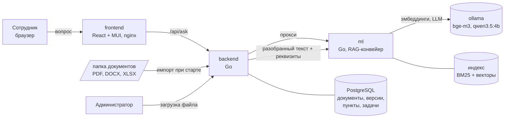

# Физтех.Ответ — навигатор сотрудника по внутренним регламентам МФТИ

Сотрудник задаёт вопрос обычным языком («Как забронировать концертный зал?»).
Система находит нужные приказы и регламенты, формирует **краткий ответ и
пошаговый порядок действий**, к каждому утверждению ставит **ссылку на
документ и пункт**, предупреждает об **изменениях редакций и противоречиях**
и честно отвечает **«в базе нет информации»**, если ответа в документах нет.

Всё работает **локально, в контуре организации**: модели запускаются в Ollama
внутри Docker Compose, документы никуда не передаются. Внешний LLM API можно
подключить одной переменной, если данные открытые.

- [Быстрый старт](#быстрый-старт)
- [Архитектура и поток данных](#архитектура-и-поток-данных)
- [Как устроен конвейер ответа](#как-устроен-конвейер-ответа)
- [Качество: замеры и сравнение подходов](#качество-замеры-и-сравнение-подходов)
- [Примеры работы (use cases)](#примеры-работы-use-cases)
- [Настройки и переменные окружения](#настройки-и-переменные-окружения)
- [API](#api)
- [Документация по компонентам](#документация-по-компонентам)
- [Деплой на сервер](#деплой-на-сервер)
- [Ограничения и план развития](#ограничения-и-план-развития)

---

## Быстрый старт

### Требования к окружению

| | Минимум | Рекомендуется |
|---|---|---|
| ОС | Linux / macOS / Windows (WSL2) | |
| Docker | Docker Engine 24+ с Compose v2 | |
| CPU / RAM | 4 vCPU / 8 ГБ | 8 vCPU / 16 ГБ |
| Диск | 15 ГБ (образы + модели) | |
| GPU | не требуется | NVIDIA GPU или Apple Silicon ускоряют генерацию в разы |
| Сеть | нужна только при первом запуске: образы и модели (~6 ГБ) | |

### Запуск

```bash
docker compose up -d --build  # первый запуск: 10–20 минут (скачивание моделей, OCR сканов)
```

`.env` не обязателен: все параметры имеют значения по умолчанию
(переопределения — в `.env.example`).

Проверка и примеры запросов:

```bash
curl localhost:8080/api/health     # {"status":"ok"}
curl localhost:8080/health/ready   # readiness (проверяет БД)
curl localhost:8000/health         # {"status":"ok","documents":N,"chunks":M}

# /api/ask требует сессионной авторизации — сначала логин:
curl -c /tmp/cookies.txt -X POST localhost:8080/api/v1/auth/login \
  -H 'Content-Type: application/json' \
  -d '{"email":"admin@example.com","password":"admin123"}'
curl -b /tmp/cookies.txt -X POST localhost:8080/api/ask \
  -H 'Content-Type: application/json' \
  -d '{"question":"Как открыть финансово-лицевой счёт?"}'
```

Демо-аккаунты (сид): `admin@example.com`/`admin123` (admin),
`ivan.petrov@example.com`/`ivan123`, `maria.sidorova@example.com`/`maria123`,
`expert@example.com`/`expert123`.

## Данные и тома

После старта:

| Сервис | Адрес |
|---|---|
| **Веб-интерфейс** | http://localhost:3000 — вход: демо-кнопки «Сотрудник» / «Администратор» |
| API бэкенда | http://localhost:8080/api/health · спецификация — `api/openapi.yaml` |
| ML-сервис | http://localhost:8000/health — число документов, фрагментов, векторов и конфигурация конвейера |
| PostgreSQL | `localhost:5433`, БД `fiztech_answer`, пользователь `fiztech_admin`, пароль `fiztech_dev_hack` (или `POSTGRES_PASSWORD`) |

Демо-учётные записи: сотрудник `ivan` / `ivan123`, администратор `admin` / `admin123`.
Новые сотрудники регистрируются сами (`/auth/register`).

Готовность: `curl localhost:8000/health` — когда `documents: 20` и
`vectors` = `chunks`, база проиндексирована.

```bash
docker compose ps                 # статус сервисов
docker compose logs -f backend ml # логи разбора документов и ответов
docker compose stop               # остановить (данные сохраняются)
docker compose down               # остановить и удалить контейнеры
docker compose down -v            # + удалить данные (БД, индекс, скачанные модели)

## Авторизация

Полный цикл аккаунта реализован и работает поверх PostgreSQL:

- **Маршруты фронта**: `/login`, `/register`, `/forgot-password`,
  `/reset-password`, `/onboarding`, `/app/profile` (плюс `/app/*`, `/admin`).
- **Сессии** — серверные, в БД хранится только SHA-256 хеш токена;
  браузер получает HttpOnly+SameSite=Lax cookie (`Secure` при https).
  «Запомнить меня» продлевает TTL сессии.
- **Пароли** — Argon2id для новых аккаунтов; bcrypt-хеши ранних
  пользователей продолжают проверяться.
- **Восстановление** — одноразовые токены (20 мин по умолчанию),
  ссылка ведёт на `APP_PUBLIC_URL/reset-password?token=…`; при сбросе
  все сессии пользователя отзываются. Письма уходят через SMTP
  (в compose — Mailpit, http://localhost:8025).
- **Onboarding** — после регистрации пользователь уходит на `/onboarding`
  (категория, подразделение, должность); до завершения защищённые
  маршруты редиректят туда.
- **Rate limiting** — на login/register/forgot/reset по IP.
- **Роли** — `employee`, `admin`, `expert`; админ-раздел `/admin`
  доступен `admin` и `expert` (проверка на backend).

Демо-аккаунты (создаются всегда; синтетические документы — только при `SEED_SYNTHETIC_DOCS=true`):
`ivan.petrov@example.com / ivan123`, `maria.sidorova@example.com / maria123`,
`admin@example.com / admin123`, `expert@example.com / expert123`.
Также работает вход по старому логину (`ivan`, `admin`, …).

### Персистентные данные (docker volumes)

| Volume         | Что хранит                              |
|----------------|-----------------------------------------|
| `pgdata`       | База PostgreSQL (документы, пользователи, ответы) |
| `ml-data`      | ML-индекс (`index.json`)                |
| `backend-data` | Загруженные исходные файлы регламентов  |

Данные переживают `docker compose down` и `restart`. Полный сброс —
`docker compose down -v`.

### Обслуживание

```bash
docker compose logs -f ml         # логи конкретного сервиса
docker compose restart backend    # перезапуск одного сервиса
docker compose up -d --build      # пересобрать и поднять в фоне
docker compose ps                 # статус и health
docker compose exec postgres psql -U fiztech_admin -d fiztech_answer  # psql
```

Порты меняются переменными `FRONTEND_PORT`, `API_PORT`, `ML_PORT`, `DB_PORT` в `.env`.

### Проверка одной командой

```bash
curl -s localhost:8080/api/ask -H 'Content-Type: application/json' \
  -d '{"question":"Как забронировать концертный зал?"}' | jq '.status, .summary, .steps, .sources[].title'
```

### Внешние сервисы

По умолчанию — **никаких**. Все модели локальные:

| Компонент | Модель | Где работает |
|---|---|---|
| Эмбеддинги | `bge-m3` (мультиязычная, 568M) | контейнер `ollama` |
| Генерация ответа, декомпозиция вопросов | `qwen3.5:4b` | контейнер `ollama` |
| Реранкинг и решение «есть ли ответ в базе» | H2O-Lightning-4B (decision model) | контейнер `decider` (llama.cpp) |
| OCR сканов | Tesseract 5 (rus+eng) | контейнер `backend` |

Опционально — любой OpenAI-совместимый API (Ollama Cloud, vLLM, OpenRouter…)
через `LLM_BASE_URL` / `LLM_API_KEY` / `LLM_MODEL`. По условиям кейса
во внешние API допустимо передавать только открытые данные; эмбеддинги
в любом случае считаются локально.

---

## Архитектура и поток данных



| Компонент | Технологии | Ответственность |
|---|---|---|
| `frontend/` | React 19, TypeScript, MUI, FSD | Чат: краткий ответ, шаги, кликабельные ссылки [n] на источники, предупреждения о редакциях, каталог документов |
| `backend/` | Go, PostgreSQL, poppler, Tesseract | Приём файлов, разбор PDF/DOCX/XLSX, OCR сканов, реквизиты (тип, №, дата), хранение версий и пунктов, очередь задач, прокси вопросов |
| `ml/` | Go (stdlib) | Разбиение на пункты, BM25 + векторный индекс, RRF, LLM-реранкинг, декомпозиция вопросов, генерация со ссылками, проверка цитат, оценка качества |
| `ollama` | Ollama | Локальный инференс моделей (эмбеддинги, генерация) |
| `decider` | llama.cpp + H2O-Lightning-4B | Калиброванная вероятность «фрагмент отвечает на вопрос» |

### Путь документа: от файла до индекса

1. **Приём.** Файлы из `ml/data/documents` импортируются при каждом старте
   (повторы отсекаются по SHA-256), новые можно загрузить через админку —
   используется один и тот же конвейер, логика не меняется.
2. **Извлечение текста** (`backend/internal/parse`):
   - DOCX, XLSX — разбор OOXML;
   - PDF — постранично `pdftotext`; страница без текстового слоя или с
     «тонким» слоем (только шапка над сканом) распознаётся **Tesseract OCR**,
     берётся более полный вариант; исправляется типичная ошибка OCR «11 Текст» → «1.1. Текст»;
   - битые файлы и нераспознаваемые сканы получают статус `requires_review`, а не роняют конвейер.

   На базе кейса: **20 из 20 документов** разобраны, 5 сканов (46 страниц) — через OCR.
3. **Реквизиты** (`backend/internal/docmeta`): тип акта, номер и дата берутся из
   имени файла и шапки («от 19.06.2026 № 2993-1», «Зарегистрировано в ЭДО от … № …»).
   Ссылки на законы и на другие приказы («Закон РФ … № 2124-1», «утратившим силу
   приказ № 138-1») отфильтровываются: лучше пустое поле, чем чужая дата.
4. **Разбиение на пункты** (`ml/internal/chunk`): текст режется по нумерации
   пунктов («3.4.», «3.4 —», «3.1.При…» после OCR) и заголовкам разделов;
   соседние пункты раздела упаковываются во фрагмент ~900 символов. Каждый
   фрагмент несёт **метку для цитаты** («п. 2.5–2.7»), заголовок раздела и
   **контекстную шапку** «Документ № … от … Раздел …», которая индексируется вместе с текстом.
5. **Индексация** (`ml/internal/store`): BM25 по основам слов (русский стеммер
   Snowball, реализован без зависимостей) + векторы `bge-m3`. Эмбеддинги
   кэшируются по хэшу текста — переиндексация не пересчитывает неизменённое.

---

## Как устроен конвейер ответа

```mermaid
flowchart TD
    Q[Вопрос] --> V{Валидация}
    V -->|мусор, пустой ввод| INV[«Уточните вопрос»]
    V --> DC{Составной?}
    DC -->|да| SUB[LLM: 2–3 подвопроса]
    DC -->|нет| R
    SUB --> R[Поиск по каждому запросу:<br/>BM25 + векторы]
    R --> F[Слияние RRF]
    F --> RR[H2O-реранкинг кандидатов<br/>по исходному вопросу и подвопросам]
    RR --> G{Есть доказательства?}
    G -->|нет| NF[«В базе нет информации»]
    G -->|да| AM[+ акты, изменяющие найденные]
    AM --> GEN[Генерация JSON:<br/>ответ, шаги, примечания,<br/>противоречия, чего не хватает]
    GEN --> CHK[Проверка цитат:<br/>удаление несуществующих [n],<br/>ответ без ссылок → «частичный»]
    CHK --> OUT[Ответ + источники + трассировка]
```

| Шаг | Зачем | Где |
|---|---|---|
| Валидация ввода | пустые, бессмысленные, слишком длинные запросы не идут в модель | `rag.validateQuestion` |
| Декомпозиция | «еду на конференцию, а после хочу провести семинар в зале» — две процедуры в одном вопросе; одиночный запрос уводит поиск к одной из них | `rag/decompose.go` |
| Гибридный поиск | BM25 точно ловит термины и номера («ФЛС», «794-1»), векторы — перефразировки («сломался ноутбук» → регламент техподдержки) | `store.SearchBM25`, `SearchVector` |
| RRF | слияние ранжированных списков без подбора весов | `rag.rrf` |
| H2O-реранкинг | H2O-Lightning-4B оценивает каждый фрагмент по исходному вопросу и подвопросам; максимальная оценка сохраняет обе части составного вопроса | `rag/rerank_decision.go` |
| Порог доказательств | отсекает вопросы вне базы до генерации — без галлюцинаций и быстрее | `rag.evidence` |
| Изменяющие акты | если найден документ, который изменён более новым актом из базы, фрагмент нового акта добавляется в контекст | `store.AmendedBy` |
| Структурированная генерация | `temperature=0`, фрагменты пронумерованы и подписаны реквизитами; модель обязана ссылаться на [n], опираться на более новую редакцию и описывать противоречия | `rag/generate.go` |
| Проверка цитат | ссылки на несуществующие фрагменты удаляются; ответ без единой ссылки понижается до «частичного» | `rag.assemble` |
| Деградация | нет эмбеддингов → только BM25; нет LLM → выдержки из найденных пунктов; нет ML → понятное сообщение в UI | везде |

Каждый ответ содержит `trace`: режим поиска, подвопросы, учтённые изменяющие
акты, модель и время этапов. В интерфейсе — строка «Как найден ответ».

---

## Качество: замеры и сравнение подходов

Набор из **39 размеченных вопросов** (`eval/questions.jsonl`): процедуры,
факты, перефразировки, составные вопросы, вопросы о редакциях, **5 вопросов,
ответа на которые в базе нет**, и некорректный ввод. Для каждого указаны
ожидаемый документ и пункт.

```bash
docker compose cp eval/questions.jsonl ml:/data/questions.jsonl
# качество поиска для разных конфигураций (ablation)
docker compose exec ml /eval -questions /data/questions.jsonl -stage retrieval \
  -configs bm25,vector,hybrid,hybrid+decide+decomp
# ответы целиком
docker compose exec ml /eval -questions /data/questions.jsonl -stage e2e -configs hybrid+decide+amend+decomp
```

### Поиск (BM25 — базовая линия)

| Конфигурация | Нужный документ найден | MRR | Нужный пункт найден | Вопросы вне базы отклонены | Ложные отказы |
|---|---|---|---|---|---|
| `bm25` (baseline) | 94% | 0.90 | 74% | 100% | 9% |
| `vector` (bge-m3) | 94% | **0.96** | 79% | 20% | 0% |
| `hybrid` (BM25 + векторы, RRF) | **97%** | 0.92 | **79%** | 20% | **0%** |

<!-- E2E-RESULTS -->

### End-to-end: выбор основного конвейера

| Метрика | H2O + декомпозиция | Альтернативный конвейер |
|---|---:|---:|
| Верный статус | **100% (39/39)** | 15% (6/39) |
| Нужный документ в источниках | **91%** | 78% |
| Нужный пункт в источниках | **100% (19/19)** | 74% |
| Процедуры с пошаговой инструкцией | **47% (7/15)** | 7% (1/15) |
| Шаги со ссылкой на источник | **87%** | 0% |
| Задержка p50 / p90 | 14.9 / 27.0 с | **7.0 / 12.7 с** |

Основным выбран H2O-конвейер: он медленнее, но корректно определил статус
всех 39 вопросов и заметно лучше подтвердил ответы источниками. Полные отчёты:
[`eval/results-e2e-ours.md`](eval/results-e2e-ours.md) и
[`eval/results-e2e-darya.md`](eval/results-e2e-darya.md).

**Выводы:**
- BM25 с русским стеммером — сильный baseline: термины регламентов
  специфичны. Но он не понимает перефразировок («сломался ноутбук, куда
  писать?» не содержит слов регламента техподдержки) и даёт 9% ложных отказов.
- Векторы закрывают перефразировки, но по одной косинусной близости нельзя
  отличить вопрос вне базы от перефразированного — поэтому решение
  «есть ли ответ» принимает реранкер-судья, а не порог.
- Гибрид объединяет сильные стороны: 97% документов без ложных отказов.

---

## Примеры работы (use cases)

### 1. Процедура: бронирование концертного зала

**Вход:** «Как забронировать Концертный зал МФТИ для проведения мероприятия?»

**Ожидаемый результат:** статус «ответ подтверждён источниками»; краткий ответ —
бронирование через служебную записку на имя начальника КМО; пошаговый
порядок (уточнить свободные даты у начальника КМО → согласовать технических
сотрудников и перемещение имущества → оформить служебную записку, подписанную
руководителем подразделения → направить на kmo@… или через 1С:Документооборот),
важные условия (срок подачи, ответственные лица); источники —
«Регламент бронирования конц зала», № 3897-1 от 01.09.2025, п. 2.5–2.7 и п. 3.6–3.8.

### 2. Вопрос о редакции: актуальный порядок внутреннего заимствования

**Вход:** «Действует ли ещё приказ № 1465-1 о внутренних заимствованиях?»

**Ожидаемый результат:** нет — приказ № 1465-1 признан утратившим силу
приказом № 5990-1 от 03.11.2026 (п. 1); с даты подписания действует новый
Регламент о внутреннем заимствовании средств в редакции приложения к этому
приказу (п. 2); источник — «Приказ № 5990-1 от 03.11.2026», п. 1–2.

### 3. Вопрос вне базы

**Вход:** «Как оформить ежегодный оплачиваемый отпуск?»

**Ожидаемый результат:** статус «информация не найдена»: «В предоставленной базе
документов нет информации, достаточной для ответа на этот вопрос» — без
выдуманной процедуры.

---

## Настройки и переменные окружения

Файл `.env` в корне (шаблон — `.env.example`).

| Переменная | По умолчанию | Назначение |
|---|---|---|
| `POSTGRES_PASSWORD` | `fiztech_dev_hack` | пароль пользователя `fiztech_admin` в PostgreSQL |
| `LLM_BASE_URL` | `http://ollama:11434/v1` | OpenAI-совместимый API для генерации |
| `LLM_API_KEY` | пусто | ключ внешнего API |
| `LLM_MODEL` | `qwen3.5:4b` | модель генерации, реранкинга и декомпозиции |
| `LLM_REASONING_EFFORT` | `none` | отключает «размышления» гибридных моделей: для ответа по фрагментам не нужны, а задержку увеличивают в разы |
| `LOCAL_LLM_MODEL` | `qwen3.5:4b` | какую LLM скачать в локальный ollama |
| `EMBED_BASE_URL` | `http://ollama:11434/v1` | API эмбеддингов |
| `EMBED_MODEL` | `bge-m3` | модель эмбеддингов |
| `RAG_MODE` | `hybrid` | `bm25` / `vector` / `hybrid` |
| `RAG_RERANK` | `decision` | `decision` — H2O-Lightning-4B, `llm` — модель генерации, `off` |
| `DECISION_BASE_URL` | `http://decider:8080` | сервер decision-модели (`/v1/systemone`) |
| `DECIDER_QUANT` | `Q4_K_M` | квантизация H2O-Lightning (`Q8_0` точнее, но медленнее на CPU) |
| `RAG_DECOMPOSE` | `true` | разбиение составных вопросов |
| `RAG_AMENDMENTS` | `true` | подтягивать изменяющие акты |
| `RAG_TOP_K` | `6` | фрагментов в контексте генерации |
| `RAG_MIN_VECTOR` / `RAG_MIN_BM25` | `0.47` / `10` | порог доказательств до реранкинга (откалиброван на наборе вопросов) |
| `FRONTEND_PORT` (`APP_PORT`), `API_PORT`, `ML_PORT`, `DB_PORT` | 3000, 8080, 8000, 5433 | порты на хосте |

**GPU / Apple Silicon.** Ollama в Docker на macOS работает только на CPU.
Для ускорения запустите Ollama на хосте (`ollama serve`, `ollama pull qwen3.5:4b bge-m3`)
и укажите в `.env`:
`LLM_BASE_URL=http://host.docker.internal:11434/v1` и `EMBED_BASE_URL=http://host.docker.internal:11434/v1`.

**Добавить документы:** положите файлы в `ml/data/documents` и выполните
`docker compose restart backend` — новые файлы будут разобраны и
проиндексированы, уже загруженные пропущены. Либо загрузите через
админ-раздел (`POST /api/v1/admin/documents/upload`, вход `admin` / `admin123`).

### Локально, без Docker (для разработки)

```bash
# 0. PostgreSQL: роль и база — backend/db/init.sql
# 1. ML-сервис
cd ml && cp .env.example .env && go run ./cmd/ml               # :8000
# 2. Backend API (+ отдельный воркер задач при желании: go run ./cmd/worker)
cd backend && cp .env.example .env && go run ./cmd/server      # :8080
# 3. Frontend
cd frontend && npm install && npm run dev                      # :5173
```

---

## API

| Метод | Путь | Описание |
|---|---|---|
| `POST` | `/api/ask` | `{question}` → `{status, summary, steps[], notes[], conflicts[], missing, sources[], trace}` |
| `GET` | `/api/v1/documents` | каталог документов с реквизитами |
| `GET` | `/api/v1/documents/{id}/sections` | пункты документа |
| `POST` | `/api/v1/admin/documents/upload` | загрузка файлов (multipart, поле `files`) |
| `GET` | `/api/v1/admin/processing` | статус разбора файлов |
| `POST` | ML `/api/retrieve` | только поиск (для отладки и оценки) |
| `GET` | ML `/health` | документы, фрагменты, векторы, конфигурация конвейера |

`status`: `answered` — ответ подтверждён ссылками; `partial` — ответ неполный
(в `missing` — чего не хватает); `not_found` — в базе нет информации;
`invalid` — запрос не распознан.

Все эндпоинты, кроме входа/регистрации, требуют сессии; изменение базы
знаний — только `admin`/`expert`. Полный каталог — [api/README.md](api/README.md),
спецификация — [api/openapi.yaml](api/openapi.yaml).

---

## Документация по компонентам

| Документ | Содержание |
|---|---|
| [backend/README.md](backend/README.md) | Go-бэкенд: пакеты, PostgreSQL и миграции, очередь задач, auth/роли, поиск, интеграция с ML, файлы |
| [frontend/README.md](frontend/README.md) | React-приложение: FSD-структура, маршруты и guard'ы, сценарии чата, документов и админки |
| [ml/README.md](ml/README.md) | RAG-конвейер: гибридный поиск, H2O-реранкинг, декомпозиция, изменяющие акты, генерация и проверка цитат |
| [api/README.md](api/README.md) | Каталог HTTP API: auth-модель, эндпоинты, SSE-протокол runs, ошибки |

---

## Деплой на сервер

Пуш в `main` запускает `.github/workflows/deploy.yml`: по SSH на сервере
выполняются `git pull --ff-only` и `docker compose up -d --build`.
Секреты: `DEPLOY_HOST`, `DEPLOY_USER`, `DEPLOY_SSH_KEY`, `DEPLOY_PORT`.
В `.env` на сервере обычно задают `APP_PORT=80`; остальные порты слушают
только `127.0.0.1`. Первый запуск скачивает модели (~6 ГБ: qwen3.5:4b,
bge-m3 в Ollama и H2O-Lightning-4B в volume `llama-cache`).

---

## Ограничения и план развития

**Ограничения сейчас**
- Качество сканов: OCR ошибается в отдельных словах и номерах пунктов; такие
  места видны в цитате, ссылка ведёт на исходный файл.
- Связи «акт A изменяет акт B» определяются по номерам и датам. В базе кейса
  изменяемые акты (№ 1465-1, 76-1, 138-1) отсутствуют, поэтому актуальность
  определяется датами документов и явными формулировками «утратил силу».
- Маленькая локальная модель (4B) иногда пишет многословно; на CPU ответ
  занимает десятки секунд, на GPU — несколько секунд.

**План внедрения**
1. Подключение к СЭД (1С:Документооборот): автоматическая загрузка новых приказов и редакций.
2. Граф нормативных связей с подтверждением экспертом (в БД уже есть таблица `document_relations` и API верификации).
3. «Непрочитанные регламенты»: уведомлять сотрудников о новых и изменённых актах по их подразделению (отметки о прочтении уже есть в API).
4. pgvector вместо in-memory индекса при росте базы до тысяч документов — интерфейс `Store` это позволяет.
5. Права доступа по уровню конфиденциальности документа (поле `access_level` уже хранится).

---

## Структура репозитория

```
backend/            Go: API, разбор документов, OCR, реквизиты, PostgreSQL, очередь задач
  internal/parse/   PDF (poppler + Tesseract), DOCX, XLSX
  internal/docmeta/ тип, номер, дата, ссылки на изменяемые акты
ml/                 Go: RAG-конвейер
  internal/chunk/   разбиение по пунктам с метками для цитат
  internal/textproc/ токенизация и русский стеммер Snowball
  internal/store/   BM25, векторный индекс, граф изменений
  internal/rag/     поиск, RRF, реранкинг, декомпозиция, генерация, проверка цитат
  cmd/eval/         оценка качества на размеченном наборе
  data/documents/   база документов кейса (20 файлов)
frontend/           React: чат, каталог, админка
eval/               размеченные вопросы и отчёты замеров
docker-compose.yml  весь стенд одной командой
```
